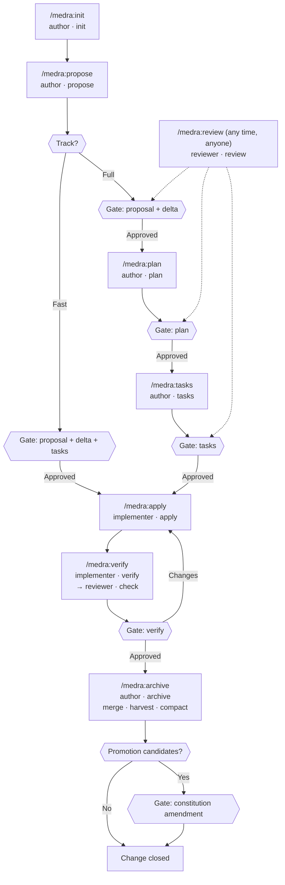

# Blueprint — medra (marketplace `flow`)

## Purpose

`medra` is a spec-driven development workflow. It takes one change, in an existing or new codebase, from intent through an approved specification, technical plan, task list, implementation and verification, and finally archives it into living specs. Every archived change also teaches the next one through project lessons and team preferences. It serves a solo developer using it daily and teams reviewing its documents in pull requests.

The workflow synthesizes two sources:
- **OpenSpec:** living specs per capability; changes with ADDED/MODIFIED/REMOVED deltas; archive merge; SHALL + WHEN/THEN scenarios; artifact dependencies as enablers.
- **GitHub Spec Kit:** a constitution with plan gates and Complexity Tracking; `[NEEDS CLARIFICATION]` markers; traceable tasks with `[P]`; a consistency analysis before a change closes.

It runs on Claude Code as the plugin `medra@flow`, and on Google Antigravity as the native plugin `medra`, generated into `.agents/plugins/medra/`. The commands are `/medra:<command>` on both. The `medra` CLI performs every deterministic operation: scaffolding, validation, gate state, task checkpoints, delta merge, context packing, the learnings store, and installation. Agents spend tokens only on judgment and writing.

## Walkthrough

1. **`/medra:init`** — Inline, `author` · init.
   - Runs `medra init`, which writes `docs/config-flow.yaml`, `docs/specs/`, `docs/changes/archive/` and an empty `docs/learnings.md`; for Antigravity it also generates the plugin into `.agents/plugins/medra/`.
   - Interviews the user and writes `docs/constitution.md`.
   - Optionally bootstraps living specs from existing code.
   - Gates: constitution; bootstrap specs.
2. **`/medra:propose <intent>`** — Inline, `author` · propose.
   - Reads `medra index` (capability and requirement titles) and the matching learnings, then classifies the track.
   - Runs `medra new` and writes `proposal.md` and the delta specs, resolving clarification markers with the user. On the fast track it also writes `tasks.md`.
   - Gate: proposal + delta (+ tasks on the fast track), recorded with `medra gate`.
3. **`/medra:plan`** (full track only) — Inline, `author` · plan.
   - Reads `medra context <change> --stage plan` and the code.
   - Writes `plan.md` with the constitution gate check, plus `contracts/` when interfaces change.
   - Gate: plan.
4. **`/medra:tasks`** (full track only) — Inline, `author` · tasks.
   - Writes `tasks.md` from the context pack and the plan.
   - Gate: tasks.
5. **`/medra:apply`** — Inline, `implementer` · apply.
   - Takes the next task from `medra context <change> --stage apply`, implements it, and records it with `medra task done <id> --evidence`.
   - Resumes from disk in any session, stops on blockers, and escalates the track when the change outgrows it.
   - No gate: the code is reversible, and the verify gate follows.
6. **`/medra:verify`** — Inline, `implementer` · verify.
   - Dispatches `reviewer` · check through `handoff-implementer-reviewer`, or runs the check inline where the runtime has no subagents.
   - Presents the verification report.
   - Gate: verify.
7. **`/medra:archive`** — Inline, `author` · archive.
   - Runs `medra archive`, which merges the deltas into `docs/specs/`, moves the change to `docs/changes/archive/YYYY-MM-DD-<name>/`, and appends a line to `docs/changes/archive/INDEX.md`. The agent resolves any conflicts the CLI reports.
   - **Harvest:** turns the verify and review findings, the gate change-request notes, and the apply blockers into lessons and preferences through `medra learn`.
   - **Compact:** runs when `medra learn status` reports the store over budget, merging duplicates and retiring stale entries.
   - **Promote:** when `medra learn candidates` lists lessons at the promotion threshold, proposes a constitution amendment. Gate: amendment.
   - Suggests a commit.
8. **`/medra:review <change>`** (any time, any person) — Inline, `reviewer` · review.
   - Runs an adversarial review of the change documents at their current stage and writes a review report.
   - Records the human reviewer's verdict with `medra review`.

Every step ends by suggesting a commit message and naming the next command. The workflow never creates branches or commits.

## Commands

| Command | Mode | Routed pipeline | Preconditions (checked with `medra status --json`) | Output |
|---|---|---|---|---|
| `init` | Inline | `medra:pipeline-author-init` | `medra --version` at the supported major | `docs/` scaffold, `constitution.md`, optional bootstrap specs; next: `/medra:propose` |
| `propose` | Inline | `medra:pipeline-author-propose` | `docs/constitution.md` ratified | Change folder path, track, gate result; next: `/medra:plan` (full) or `/medra:apply` (fast) |
| `plan` | Inline | `medra:pipeline-author-plan` | Change exists, track `full`, gate `proposal` approved | `plan.md` path, constitution-gate summary; next: `/medra:tasks` |
| `tasks` | Inline | `medra:pipeline-author-tasks` | Track `full`, gate `plan` approved | `tasks.md` path, task count; next: `/medra:apply` |
| `apply` | Inline | `medra:pipeline-implementer-apply` | Gate `tasks` approved (full) or gate `proposal` approved (fast) | Tasks done / remaining; next: `/medra:verify` or `/medra:apply` to resume |
| `verify` | Inline | `medra:pipeline-implementer-verify` | `medra status` reports every task done | Verification report path, verdict; next: `/medra:archive` |
| `archive` | Inline | `medra:pipeline-author-archive` | Gate `verify` approved | Archived path; specs touched, lessons added/bumped, entries compacted, amendment result (counts); next: `/medra:propose` |
| `review` | Inline | `medra:pipeline-reviewer-review` | Change exists and has `proposal.md` | Review report path, verdict; next: the command for the change's current stage |

Each command adopts the agent that owns its routed pipeline by reading `${CLAUDE_PLUGIN_ROOT}/agents/{agent}.md`; on Antigravity the installer rewrites that path. Every command sets `disable-model-invocation: true`, and every command's first precondition is the CLI version check.

## Agents

| Agent | Job | Model · effort | Run mode | Pipelines | Invokes |
|---|---|---|---|---|---|
| `author` | Writes the what, and the how in outline: constitution, proposals, deltas, plans, tasks. Archives changes into living specs and curates the learnings. Never writes code | opus · high | Main session (adopted by commands) | init, propose, plan, tasks, archive | `Explore` (Claude only) |
| `implementer` | Executes approved tasks in code, with evidence per task. Runs the verify gate | sonnet · high | Main session (adopted by commands) | apply, verify | `reviewer`, via `handoff-implementer-reviewer` |
| `reviewer` | Adversarial reader: judges documents and implementation against the specs, the constitution and the templates. Edits nothing except its own report | opus · high | Both: main session for `review`, delegated for `check` | review (interactive), check (single-shot) | No one (leaf) |

Model and effort take effect only when Claude Code runs the agent as a subagent (`reviewer` · check). An agent adopted inline by a command runs on the session's model, so its frontmatter only records intent.

## Documents

All documents live under `docs/` at the project root and are versioned with the code. Headings, IDs and keywords are fixed in English, and prose follows the `language` key in `docs/config-flow.yaml`.

| Document | Template skill | Filled by | Consumed by | Location and naming | Lifecycle |
|---|---|---|---|---|---|
| Constitution | `medra:template-constitution` | author · init; author · archive (amendments) | author · plan, reviewer, via `medra context` | `docs/constitution.md` | draft → ratified `vMAJOR.MINOR`; each amendment bumps the version |
| Living spec | `medra:template-spec` | author · init (bootstrap); `medra archive` (merge) | author, reviewer, via `medra index` / `medra context` | `docs/specs/<capability>/spec.md` | current (its only state) |
| Proposal | `medra:template-proposal` | author · propose | author · plan/tasks, reviewer, humans in PRs | `docs/changes/<change>/proposal.md` | draft → approved → archived |
| Delta spec | `medra:template-delta` | author · propose | author, reviewer, `medra archive` | `docs/changes/<change>/specs/<capability>/spec.md` | draft → approved → merged |
| Plan | `medra:template-plan` | author · plan | author · tasks, implementer, reviewer | `docs/changes/<change>/plan.md` (+ `contracts/*` when interfaces change) | draft → approved → archived |
| Tasks | `medra:template-tasks` | author · propose (fast track) or tasks (full track); ticks written by `medra task done` | implementer, reviewer, `medra validate` / `medra context` | `docs/changes/<change>/tasks.md` | draft → approved → in progress → done |
| Review report | `medra:template-review` | reviewer · review and check | humans; implementer · verify; author · archive (harvest) | `docs/changes/<change>/reviews/<YYYY-MM-DD>-<stage>-<reviewer>.md` (verify: `…-verify-agent-r<round>.md`) | final when written; each verify round is a new file |
| Learnings | `medra:template-learnings` | `medra learn` (writes), author · archive (judgment) | every agent, filtered through `medra context` / `medra index` | `docs/learnings.md` | entry: active → promoted / retired / merged-into `L-NNN` |
| Archive index | — (CLI-owned) | `medra archive` (one line per change: date, name, capabilities, REQ IDs touched, one-line why) | humans; author · propose (duplicate-change check); `medra context` (`last_changed_by`) | `docs/changes/archive/INDEX.md` | append-only |
| Change state | — (CLI-owned, never hand-edited) | `medra` CLI | every command's preconditions | `docs/changes/<change>/.medra.yaml` | phase: `proposed → planned → tasked → implementing → verified → archived` |
| Config | — (CLI-owned) | `medra init` | every agent (language); CLI (learning budget and threshold) | `docs/config-flow.yaml` | written at init, edited by the user |

- **Change names** are kebab-case and start with a verb (`add-password-reset`). `medra new` validates them.
- **Requirement IDs** are `<PREFIX>-<NNN>`, with the prefix declared once per capability in its living spec. Learning IDs are `L-NNN`. IDs are never renumbered.
- **Deltas** refer to requirements by ID in MODIFIED and REMOVED, so a rename is simply a MODIFIED with a new title.

## Context and memory budget

These are standing rules, held in `medra:conventions` and enforced by the CLI:

- **Read through the CLI.**
  - Agents load project knowledge from `medra index` (before a change exists) and `medra context <change> --stage <stage>` (after it exists).
  - Agents never read all of `docs/specs/`.
  - A context pack holds the constitution articles (title and gate question), the full text of every requirement the change touches, the titles of sibling requirements, the active learnings whose scope matches, and the paths of the change's documents. For each touched requirement it also gives `last_changed_by`, the path of the archived change that last touched it, taken from `docs/changes/archive/INDEX.md`.
- **The archive is reached only by pointer.**
  - An agent opens an archived change in exactly one case: the current delta MODIFIES or REMOVES a requirement. The author in plan and the reviewer in review and check then read only the `Decisions` section of that change's `plan.md`, or the `Why` section of its `proposal.md` if it had no plan.
  - Agents never browse the archive or read other archived files, because the living spec already holds the current what and the learnings already hold the distilled lessons.
- **Learnings are bounded.**
  - `docs/config-flow.yaml` sets `learning.max_active` (default 40), `learning.promote_after` (default 3 occurrences), and `learning.stale_after` (default 10 archived changes without a bump).
  - When `medra learn status` reports the store over `max_active` or holding stale entries, the archive pipeline compacts it before the change closes.
- **Progress lives on disk.**
  - Each finished task is written immediately with `medra task done`.
  - Gate notes are written with `medra gate --note`.
  - Any session resumes from `medra context` alone; the conversation is never the only copy of state.

## Behavior documentation (BDD)

Living specs are the project's living documentation. The coverage map links them to the tests, so they cannot drift from the code without the CLI noticing.

- **Scenario language.** Each scenario is a Gherkin block with `Given / When / Then`, and optional `And` / `But` steps, under `#### Scenario <REQ-ID>.S<n>: <title>`, for example `AUTH-004.S1`. Scenario IDs are stable, are never renumbered, and are assigned by the author (`medra validate` checks they are unique). MODIFIED requirements repeat every scenario in full; a removed scenario's ID is retired.
- **Scenario → test traceability.** Every automated test that covers a scenario cites its ID in a comment, a tag or the test name (`AUTH-004.S1`). `medra coverage <change>` (or `--all`) searches the test paths in `testing.paths` (config) and reports each scenario as `covered` (with file:line) or `uncovered`. The command is deterministic and makes no model call.
- **Where coverage bites.**
  - In `tdd` and `test-after`, `medra validate <change> --stage verify` fails while any scenario the change adds or modifies is uncovered.
  - reviewer · check reads the coverage report instead of hunting for tests, and judges only whether each test actually exercises its scenario.

## Testing discipline

`docs/config-flow.yaml` sets `testing.mode` to `tdd`, `test-after` or `none`. The default is `tdd`, and the user chooses during the init interview. The setting applies to both tracks.

| Stage | `tdd` | `test-after` | `none` |
|---|---|---|---|
| Delta | Every scenario (WHEN/THEN) is a test case in waiting; this holds in every mode | same | same |
| Plan | Mandatory **Test strategy** section: the level of each scenario (contract → integration → unit), the framework, and the project's test command | Same section | Section states "No automated tests" with the reason |
| Tasks | For each requirement, a `[TEST]` task that writes its scenarios' tests comes before the implementation task, and the implementation task declares `after T00X`. `medra validate` fails a requirement with no test task, and fails an implementation task that is not after its test task | Test tasks are required per requirement, with no ordering | Each task carries a manual verification step |
| Apply | `medra task done` accepts a `[TEST]` task only with red evidence (the failing command and a short output excerpt). It accepts an implementation task only once every task it is `after` is done, with green evidence from the same tests | Green evidence is required on test tasks | The manual verification result is required |
| Check | The reviewer confirms that every scenario maps to a test, that red/green evidence exists, and that no test was weakened, deleted or skipped to reach green | Every scenario maps to a test with green evidence | Every scenario maps to recorded manual verification |

On the fast track, a fix is **regression-first**: the first task is a `[TEST]` that reproduces the defect (red), and the fix follows (green).

## Contracts

| Handoff | Sender | Receiver | Trigger | Dispatch fields | Response fields |
|---|---|---|---|---|---|
| `handoff-implementer-reviewer` | implementer · verify | reviewer · check | `medra status` reports every task done and `medra validate <change> --stage tasks` passes | `change` (name), `change_path`, `diff_base` (git ref the change started from, or `none`), `report_path` (where to write the report), `language` | `verdict` (`pass` / `pass-with-findings` / `fail`), `report_path`, `counts` (critical / major / minor), `unverified` (count of requirements with no evidence) |

The CLI contract that every pipeline depends on is specified in [`cli/SPEC.md`](../../cli/SPEC.md). `medra:conventions` holds the agent-facing summary of it: commands, exit codes, and the state file.

## Artifacts

In build order. Paths are relative to `/home/tcavalli/src/harness/`.

| # | Type | Runtime name | Path | Job | Depends on |
|---|---|---|---|---|---|
| 1 | CLI spec (engineering handoff) | — | `cli/SPEC.md` | Contract for the `medra` Node CLI: commands, flags, exit codes, state and config schemas, validation rules, merge rules, context-pack selection, the learnings store, the installer rewrite table | — |
| 2 | Protocol | `medra:conventions` | `plugins/medra/skills/conventions/SKILL.md` | Shared rules for every agent: `docs/` layout, language, CLI usage and exit codes, context and memory budget, gate protocol with or without `AskUserQuestion`, delegation and skill-loading fallbacks, resume-from-disk, git suggest-only | 1 |
| 3 | Template | `medra:template-constitution` | `plugins/medra/skills/template-constitution/` | Versioned, numbered articles with testable gate questions and an amendment log | 2 |
| 4 | Template | `medra:template-spec` | `plugins/medra/skills/template-spec/` | Living spec per capability: Purpose, ID prefix, `REQ` blocks with SHALL + scenarios | 2 |
| 5 | Template | `medra:template-delta` | `plugins/medra/skills/template-delta/` | Delta spec: ADDED / MODIFIED / REMOVED requirement sections, in the exact form `medra archive` parses | 4 |
| 6 | Template | `medra:template-proposal` | `plugins/medra/skills/template-proposal/` | Why, scope fence, track with rationale, capabilities touched, impact, clarification markers | 2 |
| 7 | Template | `medra:template-plan` | `plugins/medra/skills/template-plan/` | Anchored: approach, constitution gate check, Complexity Tracking, decisions, data and contract changes | 3, 6 |
| 8 | Template | `medra:template-tasks` | `plugins/medra/skills/template-tasks/` | Phased checkbox tasks `T001 [P] [REQ X-001]` with verification per task and a CLI-written evidence line | 5, 7 |
| 9 | Template | `medra:template-review` | `plugins/medra/skills/template-review/` | Findings report shared by review and check: stage, verdict, severity-classified findings, requirement coverage | 5, 8 |
| 10 | Template | `medra:template-learnings` | `plugins/medra/skills/template-learnings/` | `L-NNN` entries: type (lesson / preference), scope, statement, evidence, occurrences, status; harvest, merge and retirement rules | 2 |
| 11 | Handoff | `medra:handoff-implementer-reviewer` | `plugins/medra/skills/handoff-implementer-reviewer/SKILL.md` | The verify dispatch contract (Contracts row) | 9 |
| 12 | Pipeline | `medra:pipeline-author-init` | `plugins/medra/skills/pipeline-author-init/SKILL.md` | CLI init, language and integrations, constitution interview + gate, optional brownfield bootstrap + gate | 2, 3, 4 |
| 13 | Pipeline | `medra:pipeline-author-propose` | `plugins/medra/skills/pipeline-author-propose/SKILL.md` | Intake, track classification, clarification, proposal + deltas, fast-track tasks, self-review, gate | 2, 5, 6, 8 |
| 14 | Pipeline | `medra:pipeline-author-plan` | `plugins/medra/skills/pipeline-author-plan/SKILL.md` | Grounding in the context pack and code, plan with constitution gates, self-review, gate | 2, 7 |
| 15 | Pipeline | `medra:pipeline-author-tasks` | `plugins/medra/skills/pipeline-author-tasks/SKILL.md` | Task decomposition with traceability, self-review, gate | 2, 8 |
| 16 | Pipeline | `medra:pipeline-author-archive` | `plugins/medra/skills/pipeline-author-archive/SKILL.md` | Merge with conflict resolution, harvest learnings, compact when over budget, promote to the constitution with a gate | 2, 3, 5, 10 |
| 17 | Pipeline | `medra:pipeline-implementer-apply` | `plugins/medra/skills/pipeline-implementer-apply/SKILL.md` | Resume from the context pack, execute tasks with CLI checkpoints, blocker handling, track escalation | 2, 8 |
| 18 | Pipeline | `medra:pipeline-implementer-verify` | `plugins/medra/skills/pipeline-implementer-verify/SKILL.md` | Dispatch check (or inline fallback), fix loop, gate | 2, 9, 11 |
| 19 | Pipeline | `medra:pipeline-reviewer-review` | `plugins/medra/skills/pipeline-reviewer-review/SKILL.md` | Interactive, stage-aware document review, report, human verdict | 2, 9 |
| 20 | Pipeline | `medra:pipeline-reviewer-check` | `plugins/medra/skills/pipeline-reviewer-check/SKILL.md` | Single-shot check of implementation against spec, plus cross-document consistency | 2, 9, 11 |
| 21 | Agent | `medra:author` | `plugins/medra/agents/author.md` | See Agents | 12–16 |
| 22 | Agent | `medra:implementer` | `plugins/medra/agents/implementer.md` | See Agents | 17, 18 |
| 23 | Agent | `medra:reviewer` | `plugins/medra/agents/reviewer.md` | See Agents | 19, 20 |
| 24–31 | Command ×8 | `medra:{init,propose,plan,tasks,apply,verify,review,archive}` | `plugins/medra/skills/{verb}/SKILL.md` | See Commands | 21–23 |
| 32 | Plugin manifest | `medra` | `plugins/medra/.claude-plugin/plugin.json` | Name, version, description, author; no dependencies | 24–31 |
| 33 | Marketplace manifest | `flow` | `.claude-plugin/marketplace.json` | Registers `medra` from `./plugins/medra` | 32 |
| 34 | README | — | `README.md` | Install and first run on Claude Code and Antigravity, plus the command list | 33 |

## Decisions

| Decision | Strongest rejected alternative | Reason |
|---|---|---|
| Portable core: every step is a skill that runs inline in the main session. Subagents are only an optimization (reviewer · check), with an inline fallback | A Claude-native topology with a subagent per step | Antigravity plugins now have subagents with enforced tool grants and `ask_question` (verified with agy 1.4.10, 2026-10-30), so reviewer · check runs isolated there too. The inline fallback stays for runtimes without subagents, and keeping every step in the main session keeps the gates interactive everywhere |
| The native Claude Code plugin is the source of truth. Antigravity gets a generated native plugin (`medra install --target antigravity`): Antigravity namespaces plugin skills as `/medra:<skill>`, so skill names and `medra:` references stay; agents become `medra-<agent>` with tool grants mapped to Antigravity tool names; `${CLAUDE_PLUGIN_ROOT}`, `${CLAUDE_SKILL_DIR}` and `$ARGUMENTS` are rewritten because Antigravity substitutes no variables | A hand-maintained second copy for Antigravity; `agy plugin install` converting the Claude plugin directly | One source and a deterministic rewrite table, checked by both `claude plugin validate` and `agy plugin validate --strict`. The direct conversion only adds a manifest: it drops the commands (no `name:`) and the agents (Claude tool and model names) |
| Deterministic operations live in a Node CLI (`medra`) that uses npm packages. Agents call it and never hand-edit state | Model-performed merge, validation, checkpoints and state edits | User requirement. Models apply merges and checklists inconsistently, and gate records have to be trustworthy for teams |
| The CLI is specified in `cli/SPEC.md` and implemented by an engineering session | The Architect writes the CLI | The Architect writes instruction artifacts only; code needs engineering review |
| The CLI is installed globally (`npm i -g`). Every command's first precondition is `medra --version` matching the supported major, with install instructions on failure | `npx -y <pkg>@<ver>` on every call | Works offline, is fast on every call, and works in non-Node projects. The version check keeps the skills and the CLI in step |
| Hybrid document model: OpenSpec living specs + deltas + archive, with the Spec Kit constitution, plan gates, clarification markers and traceable tasks | Spec Kit per-feature folders | Per-feature specs go stale in brownfield and team use. Living specs keep one current truth that can be reviewed in PRs |
| Requirements are keyed by stable IDs (`AUTH-004`), and deltas reference those IDs | OpenSpec name-keyed requirements | Deterministic merge, renames without a RENAMED section, and precise traceability for tasks and reviews |
| The fast track is the default. The author classifies by explicit criteria and escalates to the full track. The fast track merges the proposal and tasks gates into one | Always running the full flow | User requirement. Two gates that are always approved together are one gate |
| Three agents (author, implementer, reviewer) | Four, with a separate planner | The delta and plan templates already enforce the what/how separation, and a separate planner adds a context boundary with no distinct tool set. The implementer earns its place by writing code, the reviewer by adversarial isolation |
| `medra gate` records gates and refuses when the stage fails `medra validate` | Approval stated in chat only | Teams need an auditable record of who approved what. The CLI makes an invalid document impossible to approve |
| `/medra:review` is a separate interactive step that anyone can run, in addition to the inline gates | Review only at the inline gates | Team PR review happens in another session, by another person. The verdict is recorded in the change state |
| Learnings are harvested once per change, at archive, from evidence already on disk | Capturing at every gate | The outcome is known only at archive, and a single harvest keeps gates light and duplicates rare. Gate notes wait in the state file until then |
| Lessons and preferences share one store, `docs/learnings.md`, typed per entry, with scope tags that `medra context` filters on | Separate files per kind | One ID space, one compaction rule, one filter. Type and scope are enough to route each entry to the agent that needs it |
| Promotion to the constitution is proposed at archive when a lesson reaches `promote_after`, behind a human gate | Automatic promotion | The constitution gates every plan, so a change to it has the widest blast radius in the system |
| Compaction is automatic at archive when the store is over budget, with no gate | A manual `/medra:compact` command | A step that has to be remembered gets forgotten. Compaction is reversible through git and is reported as counts |
| Long applies use a single session with per-task CLI checkpoints and resume from `medra context` | A subagent per task group on Claude Code | Portable, and needs no extra handoff. Checkpoints make Claude's own compaction and a fresh session both lossless |
| Agents read project knowledge only through `medra index` and `medra context` | Agents glob `docs/specs/` and the archive | The read cost tracks the change, not the size of the project's history |
| The archive is reachable only through a `last_changed_by` pointer, when a requirement is MODIFIED or REMOVED, and only for that change's Decisions/Why | Never reading the archive; or merging a rationale line into living specs | The living spec loses the why. Without it, agents re-litigate rejected alternatives. A rationale merged into living specs bloats them and goes stale |
| TDD is a workflow setting (`testing.mode`, default `tdd`) enforced by the CLI: test-before-implementation ordering in `validate`, red/green evidence in `task done`. The reviewer audits for weakened tests | A constitution article left to each project | A rule only the model enforces gets skipped under pressure, and the red step is the first to go. A constitution article gives the tasks no structure and the apply step nothing to check |
| Scenarios use Gherkin `Given/When/Then` with stable IDs `<REQ>.S<n>`, and tests cite those IDs so that `medra coverage` maps scenarios to tests | OpenSpec `WHEN/THEN` without IDs; or exporting executable `.feature` files | `Given` makes the precondition explicit for non-code readers, and IDs give deterministic traceability. Executable Gherkin needs step definitions most projects will not maintain. It stays out of v1 |
| On the fast track, bugfixes are regression-first | TDD optional on the fast track | A reproducing test is the cheapest and highest-value test a fix can have |
| Documents live in `docs/`, with the config at `docs/config-flow.yaml` (1.1). Every CLI command auto-migrates a 1.0 `medra/` folder with `git mv`, re-signing gates that were valid | A dedicated `medra/` folder; a manual `medra migrate` command | Specs read as project documentation in `docs/`. A distinct config name avoids mistaking another tool's `docs/config.yaml` for a medra project. Automatic migration means nobody has to remember the upgrade step, and change-relative gate hashes keep the move from staling approvals |
| Git: suggest commit messages and branch names only | A branch per change (Spec Kit) | Teams keep their own branching conventions |
| No Evolution Close-out in these agents | Depending on the meta-harness `medra:workspace-evolution` | The shared plugin name `medra` makes that dependency unresolvable, `.workspace/` does not exist on Antigravity, and end users of this workflow are not fleet maintainers |
| Plugin name `medra` in marketplace `flow` | `medra-sdd` | User decision. The namespace collision with the meta-harness `medra` is mitigated by having no shared skill or agent names, which Integration verifies |

## Open items

- **CLI implementation.** `cli/SPEC.md` must be implemented and `medra` published before the first real run. Default: an engineering session implements it in `cli/`, publishing under the npm name settled in the next item.
- **npm package name.** Decided: `@medra.dev/flow`, with binary `medra`, published under the user's npm org `medra.dev`.
- **Namespace risk.** `medra@flow` and `medra@meta-agent` both expose `medra:*` on Claude Code. Default: keep their names disjoint, and revisit if Claude Code documents how same-name plugins behave.
- **Antigravity auto-invocation.** Antigravity has no `disable-model-invocation`, so every command's description opens with "Run only when the user explicitly invokes it". Default: accept that prompt-level guard. For the same reason the internal skills (pipelines, templates, `conventions`, the handoff) also appear in the Antigravity `/` menu, since there is no `user-invocable: false`. Revisit if Antigravity documents either key.
- **Direct constitution amendment.** v1 amends the constitution only through promotion at archive. Default: for anything else, the user edits `docs/constitution.md` and bumps its version; add a `/medra:constitution` command if direct amendments become frequent.
- **Executable Gherkin and readable docs.** v1 has no `.feature` export (`bdd.runner`) and no `medra docs` site. Default: add both as CLI features later. The scenario format already fits Gherkin, so the skills need no change.
- **Workflow self-improvement.** Friction with the medra skills themselves is not captured. Default: none. Revisit by adding an opt-in friction log feeding the Architect's evolution review.
