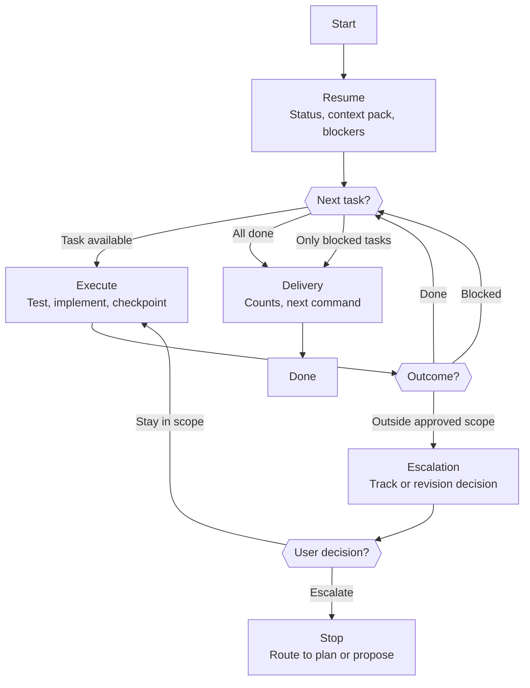

# Pipeline: Apply

## Purpose

This pipeline turns an approved task list into working code. Each finished task is ticked, with its evidence, by `medra task done` the moment it completes, so any session can stop and resume without losing work. It runs interactively when the user runs apply, both to start and to resume, and pauses only for blockers and for scope that exceeds the approved change; it has no approval gate, because the verify gate follows. It differs from verify by building rather than judging.

## Presentation

Phase headers for this pipeline:

| Phase | Header |
|---|---|
| Resume | `Implementer \| Resume` |
| Execute | `Implementer \| Execute` |
| Escalation | `Implementer \| Escalation` |
| Delivery | `Implementer \| Delivery` |

## Constraints

- **Hold every task to the approved deltas and plan.** When the code needs behavior that no approved requirement states, stop and escalate. Behavior built without a requirement has no scenario, no test, and nobody who approved it.
- **Checkpoint each task the moment it is done, with `medra task done`, before starting the next.** A context compaction or a closed session between two tasks loses everything not yet on disk, and the next session would redo or skip work.

## Flow

## Phases

### Phase 1 — Resume

**Goal**
The next executable task identified from disk, with its requirements, test strategy and any open blockers in hand.

**Actions**
- Read `${CLAUDE_PLUGIN_ROOT}/references/conventions.md`, then run `medra status <change> --json` and `medra context <change> --stage apply --md`
- Read the next task, its requirements (full blocks) and the Test Strategy, plus `testing.mode` and `testing.command` from `docs/config-flow.yaml`
- Show the user the open blockers and ask, with `AskUserQuestion`, whether each one is resolved. Run `medra task unblock` for each resolved one
- Read the code files the next task names, and the matching active learnings from the context pack

**Avoid**
- Don't reconstruct progress from the conversation — because the CLI's task state is authoritative, and a remembered "done" that was never checkpointed is not done

**Exit when:**
- [ ] `next_task` from the context pack is known, or it is `null` with the reason (all done, or only blocked tasks left)
- [ ] Every open blocker was confirmed with the user as still open or resolved

---

### Phase 2 — Execute

**Goal**
The current task implemented in code and checkpointed by `medra task done`, with the evidence its kind requires.

**Actions**
- **For a `[TEST]` task:** write tests that cite each scenario ID they cover (in a comment, tag or test name), run the focused test command, and in `tdd` mode confirm they fail for the reason the scenario predicts. Then run `medra task done <change> <T> --run "<focused command>" --kind red` (`green` in `test-after`)
- **For an implementation task:** write the minimum code that satisfies the requirement, run its tests to green, refactor while they stay green, then run `medra task done <change> <T> --run "<focused command>"`
- **Same-session `[P]` batching:** when `medra context` (`## Parallel batch`) or `medra task done` lists multiple `[P]` tasks from the same phase and kind (`[TEST]` or implementation), write or edit their files in parallel tool calls in the same turn, then checkpoint each task individually with `medra task done <change> <T> ...`
- When there is no test command (mode `none`), perform the task's verify step and record it with `--evidence "<what was checked and observed>" --kind manual`
- When the task cannot proceed (missing access, unclear spec, an external failure), run `medra task block <change> <T> --note "<cause>"` and continue with the next task whose dependencies allow it
- Take the following task (`Next task` or `Parallel batch`, including its requirements) directly from the `medra task done` or `medra task block` output without re-running `medra context`, then repeat

**Avoid**
- Don't weaken, skip or delete a test to reach green — `medra task done` hashes the test files at `red` and refuses `green` (`task.test-tampered`) if they were modified, and runs `testing.checks` (`task.check`) when configured
- Don't edit `tasks.md` checkboxes or evidence lines by hand — because `medra task done` enforces ordering and evidence; a hand tick is a task with no proof
- Don't batch several tasks before checkpointing — because a compaction mid-batch loses every unrecorded task

**Exit when:**
- [ ] `medra task done` exited `0` for the task, or `medra task block` recorded its blocker
- [ ] Every test written for the task cites its scenario IDs

---

### Phase 3 — Escalation

**Goal**
A user decision on work that exceeds the approved change, before any of that work is written.

**Actions**
- State what the task needs that the approved deltas or plan do not cover, and name the kind of growth it is: a new capability, a data or interface change, a new dependency, a security change, or more than 8 tasks
- Offer the options with `AskUserQuestion`, recommendation first: stay inside the approved scope with a narrower implementation; switch to the full track (`medra track <change> full --reason "…"`, then `/medra:plan`); or revise the behavior with `/medra:propose <change>`
- Record the situation with `medra task block <change> <T> --note "<scope gap>"` whenever the decision takes the work out of apply

**Avoid**
- Don't implement the extra scope first and ask afterwards — because code written ahead of approval anchors the decision and bypasses the gates the user chose

**Exit when:**
- [ ] The user chose an option in an explicit reply
- [ ] A track switch or a blocker is recorded in `medra status <change> --json` whenever the work leaves apply

---

### Phase 4 — Delivery

**Goal**
A bounded progress summary with the next command.

**Actions**
- Report the tasks done this run, the tasks remaining and the open blockers, from `medra status <change> --json`
- Suggest a commit as `${CLAUDE_PLUGIN_ROOT}/references/conventions.md` → Commit Suggestions describes it
- Name the next command: `/medra:verify` when every task is done, otherwise `/medra:apply` to resume

**Avoid**
- Don't list every edited file — because the diff shows them; the summary gives counts

**Exit when:**
- [ ] The summary's counts match `medra status <change> --json`
- [ ] The next command matches the task state
