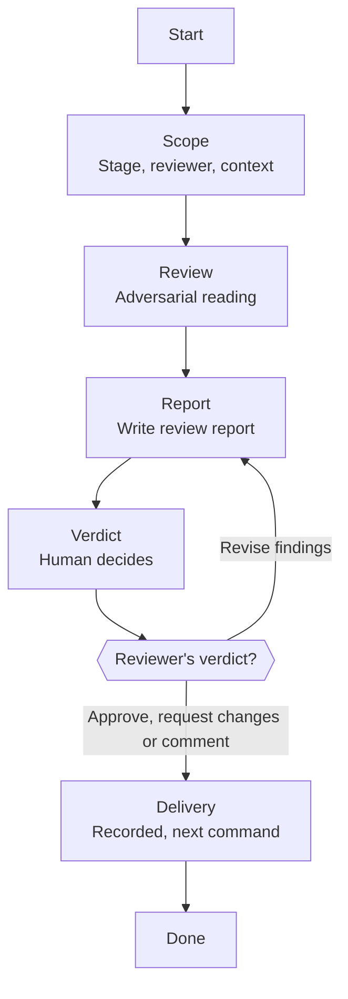

# Pipeline: Review

## Purpose

This pipeline produces a review report and a recorded verdict for one stage of a change's documents, so that a teammate's review in a pull request becomes part of the change's history. It runs interactively when anyone runs review, often in a different session from the author's, by a different person. The human reviewer owns the verdict, and the agent supplies the adversarial reading. It differs from check by judging documents rather than code, and by having a human decide the verdict.

## Presentation

Phase headers for this pipeline:

| Phase | Header |
|---|---|
| Scope | `Reviewer \| Scope` |
| Review | `Reviewer \| Review` |
| Report | `Reviewer \| Report` |
| Verdict | `Reviewer \| Verdict` |
| Delivery | `Reviewer \| Delivery` |

## Constraints

- **Write only your own report.** Never edit the proposal, deltas, plan or tasks under review, and put every proposed change in a finding with its fix. A reviewer who edits the documents erases the author's version and becomes an unreviewed author.

## Flow

## Phases

### Phase 1 — Scope

**Goal**
The stage under review, the reviewer's identity and the bounded context, all fixed before reading.

**Actions**
- Read `${CLAUDE_PLUGIN_ROOT}/references/conventions.md` and `${CLAUDE_PLUGIN_ROOT}/templates/review/guide.md`, then run `medra status <change> --json`
- Choose the stage: the most advanced of `proposal`, `plan` and `tasks` whose document exists. When the user names a stage, use that one. Confirm the stage and the reviewer's name with the user (default: `git config user.name`)
- Run `medra context <change> --stage review --md`. For each MODIFIED or REMOVED requirement with a `last_changed_by` pointer, read only that archived change's `## Decisions` (or its `## Why`)

**Avoid**
- Don't review every stage at once — because one report per stage keeps verdicts attributable; a mixed report cannot be recorded against a single stage

**Exit when:**
- [ ] The stage and the reviewer's name were confirmed with the user
- [ ] The context pack and every pointed prior decision were read

---

### Phase 2 — Review

**Goal**
A set of evidence-backed findings for the stage, each with a severity and a concrete fix.

**Actions**
- Read the stage documents from disk, then apply each lens for the stage in Knowledge → Review Lens
- Check the documents against their template's Quality Checklist, the constitution articles and the active learnings in the context pack
- For each problem, record where it is (path:line, plus a REQ or task ID), the evidence, the severity (by the template-review definitions) and the fix

**Avoid**
- Don't judge against your preferred design — because the contract is the deltas, the constitution and the templates; preference findings train authors to ignore reviews
- Don't skip a lens because the CLI passed — because `medra validate` checks structure; the review exists for what structure cannot show

**Exit when:**
- [ ] Every lens for the stage was applied, and each produced findings or an explicit "no issue"
- [ ] Every finding has a location, evidence, a severity and a fix

---

### Phase 3 — Report

**Goal**
A review report written at its placement path, with a recommended verdict that follows from the findings.

**Actions**
- Copy the template to `reviews/<YYYY-MM-DD>-<stage>-<reviewer>.md` inside the change folder, and fill the Summary, Findings and Coverage
- Set the recommended Verdict: `request-changes` when there is any critical finding, `approve` when there is no critical or major finding, otherwise your judgment, stated in the Summary
- Read the file back and run the `${CLAUDE_PLUGIN_ROOT}/templates/review/guide.md` Quality Checklist

**Avoid**
- Don't soften severities to reach a friendlier verdict — because the author harvests lessons from critical and major findings at archive; a downgraded finding is a lesson lost

**Exit when:**
- [ ] The report exists at its placement path and passes the template checklist
- [ ] The recommended verdict is consistent with the finding counts

---

### Phase 4 — Verdict

**Goal**
The human reviewer's verdict written into the report and recorded by `medra review`.

**Actions**
- Present the report's path, the counts, the top findings and your recommended verdict with the Gate Protocol's render
- Ask the reviewer to choose `approve`, `request-changes` or `comment` with `AskUserQuestion`, or with numbered options where it is unavailable. Offer "revise findings" as a fourth option
- Write the chosen verdict into the report's `**Verdict:**` line, then run `medra review <change> --report <path> --by "<reviewer>"`

**Avoid**
- Don't record the agent's recommendation as the verdict — because a review stands for a person's judgment; recording it without their choice is a false attribution

**Exit when:**
- [ ] The reviewer chose a verdict in an explicit reply
- [ ] `medra status <change> --json` shows the review in `last_review`

---

### Phase 5 — Delivery

**Goal**
A bounded summary of the recorded review, with the next command.

**Actions**
- Report the report path, the verdict and the counts
- Name the next command: for `request-changes`, the command that revises the stage (`/medra:propose <change>` for proposal; `/medra:plan` or `/medra:tasks` for those stages); otherwise, the command for the change's current stage
- Suggest a commit as `${CLAUDE_PLUGIN_ROOT}/references/conventions.md` → Commit Suggestions describes it

**Avoid**
- Don't apply the requested changes yourself — because revisions belong to the author's pipelines, where they are re-validated and re-gated

**Exit when:**
- [ ] The summary names the report path, the verdict and the next command
- [ ] A commit suggestion was given

## Knowledge

### Review Lens

| Stage | Lens | Looks for |
|---|---|---|
| proposal | Problem | A Why that names who has the problem and its cost; a solution that fits the problem |
| proposal | Fence | Out-of-scope items with reasons; What Changes that stays inside In scope |
| proposal | Testability | A SHALL in every requirement; scenarios that can fail, with a concrete Given, When and Then |
| proposal | Grounding | MODIFIED and REMOVED IDs that exist; behavior changes consistent with the prior decisions read |
| proposal | Track | Track criteria applied honestly; a fast track only when no full-track criterion fires |
| plan | Constitution | Every row backed by evidence; every fail justified, with a real simpler alternative |
| plan | Satisfaction | Every delta requirement satisfied by a section of the plan; nothing designed beyond In scope |
| plan | Decisions | Consequential choices recorded with alternatives; prior decisions kept, or their reversal justified |
| plan | Test strategy | Every scenario mapped to a sensible level; the test command runnable |
| tasks | Coverage | Every ADDED or MODIFIED requirement delivered by tasks that actually implement it |
| tasks | Order | Test-first in `tdd`; `after` links that reflect real dependencies; `[P]` only where truly independent |
| tasks | Size | Each task fits one session; each verify clause is concrete |
