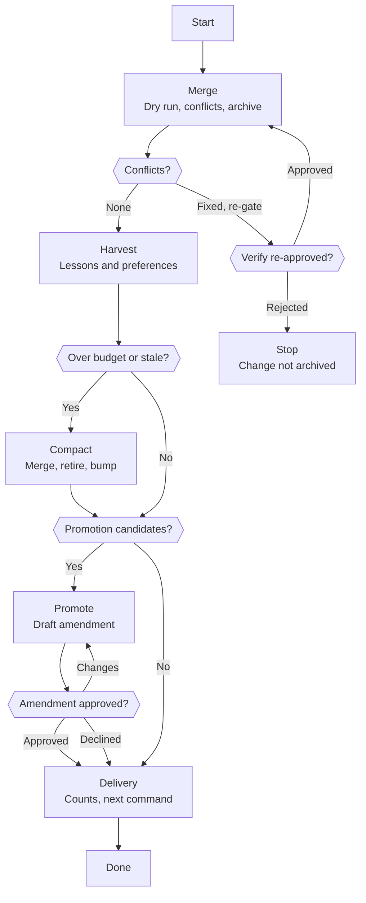

# Skill: Pipeline — Archive

## Purpose

This pipeline closes a verified change. It produces updated living specs, an archived change folder with its index line, an updated learnings store, and, when a lesson has recurred enough, an amended constitution. It runs interactively when the user runs archive. A human gate guards only the constitution amendment, and the conflict fixes that make the verify gate stale; merge, harvest and compaction are reversible through git and reported as counts. It is the only pipeline that writes the learnings store and amends the constitution.

## Presentation

Phase headers for this pipeline:

| Phase | Header |
|---|---|
| Merge | `Author \| Merge` |
| Harvest | `Author \| Harvest` |
| Compact | `Author \| Compact` |
| Promote | `Author \| Promote` |
| Delivery | `Author \| Delivery` |

## Constraints

- **Write learnings only through `medra learn`, and only from evidence on disk.** The store is filtered into every future agent's context; an entry with no artifact behind it, or a hand edit the CLI cannot parse, poisons every later run that loads it.

## Flow



## Phases

### Phase 1 — Merge

**Goal**
The change's deltas merged into `docs/specs/`, with the change folder moved into the archive by `medra archive`.

**Actions**
- Load `medra:conventions`, then run `medra archive <change> --dry-run --json`
- On exit `3`, resolve each conflict according to Knowledge → Conflict Resolution. Any edit to a stage document makes the verify gate stale, so present the fix with the Gate Protocol for gate `verify` and record the decision with `medra gate`
- Once the dry run exits `0`, run `medra archive <change> --json` and note the archived path, the sequence number and the spec counts

**Avoid**
- Don't edit living specs by hand to make the merge pass — because living specs change only through merged deltas; a hand edit has no proposal, no gate and no archive record
- Don't archive with a stale verify gate — because the archived documents would differ from what the user verified

**Exit when:**
- [ ] `medra archive --json` returned `ok: true`, with the archived path
- [ ] `medra validate --project specs` exits `0` after the merge

---

### Phase 2 — Harvest

**Goal**
Every lesson and preference evidenced by this change recorded in the learnings store as an add or a bump, with everything else deliberately skipped.

**Actions**
- Load `medra:template-learnings`, then read the harvest sources in the archived folder: the critical and major findings in `reviews/`, plus `gate_notes`, resolved `blockers` and `track_history` in `.medra.yaml`
- For each candidate, check the active entries (`medra context` is no longer available after archive, so read the `## Active` section of `docs/learnings.md`), then decide add, bump or skip using the template's rules
- Run `medra learn bump` or `medra learn add` for each decision, with the narrowest scope that changes behavior

**Avoid**
- Don't record what the living spec or the constitution already states — because duplicates inflate every context pack while adding nothing an agent did not already receive
- Don't record incidents instead of rules — because "the SMTP sandbox failed on 2026-10-30" teaches nothing; "run the mail tests against the local catcher" does

**Exit when:**
- [ ] Every critical or major finding and every gate note was decided as add, bump or skip
- [ ] `medra validate --project learnings` exits `0`

---

### Phase 3 — Compact

**Goal**
A learnings store within `learning.max_active`, with no stale entries left unhandled.

**Actions**
- Run `medra learn status --json` and read the over-budget flag and the stale list
- Merge entries that state the same rule (`medra learn merge`, into the entry with more occurrences)
- For each stale entry, run `medra learn retire --reason stale`, unless it guards a rare but costly failure; bump that one with the current change as evidence
- Re-run `medra learn status --json` until `over_budget` is `false`

**Avoid**
- Don't retire an entry just to reach the budget when it is still earning its place — because a lost lesson costs a repeated failure; merge duplicates first, then retire the least-used entry that is not guarding something

**Exit when:**
- [ ] `medra learn status --json` reports `over_budget: false`
- [ ] Every entry on the stale list was retired or bumped

---

### Phase 4 — Promote

**Goal**
A user decision on each promotion candidate: approved and ratified as a constitution amendment, or declined.

**Actions**
- Run `medra learn candidates --json`. For each candidate, judge whether it can be written as a gateable article (MUST principle, yes/no Gate). Leave the ones that cannot as active learnings
- Load `medra:template-constitution` and draft each gateable candidate as a new article, or as an edit to an existing one
- Gate each amendment with the Gate Protocol's render and options. On approval, run `medra constitution ratify --bump minor --note "<summary>" --source <L-NNN>`, then `medra learn promote <L-NNN> --article <Roman>`

**Avoid**
- Don't amend the constitution without an explicit approval — because every future plan is gated against it; an unapproved article silently changes the rules for the whole team

**Exit when:**
- [ ] Every candidate was promoted, declined by the user, or judged not gateable, with the reason stated
- [ ] Every approved amendment shows the bumped version in `medra status --json`

---

### Phase 5 — Delivery

**Goal**
A bounded summary of everything the archive changed, with the next command.

**Actions**
- Report the archived path, the spec counts, the learnings counts (added, bumped, merged, retired, promoted) and the constitution version
- Suggest a commit as `medra:conventions` → Commit Suggestions describes it
- Name the next command: `/medra:propose`

**Avoid**
- Don't list each learning in full — because the store is in the diff; counts keep the summary readable however much was harvested

**Render**

```
> # Author | Delivery
> *{change} · archived #{sequence}*
>
> 🗂️ **Specs**
> Added: `{n}` · Modified: `{n}` · Removed: `{n}` · Capabilities: `{n}`
>
> 🧠 **Learnings**
> Added: `{n}` · Bumped: `{n}` · Merged: `{n}` · Retired: `{n}` · Promoted: `{n}`
>
> 📜 **Constitution**
> Version: `{version}`
>
> 👉 **Next**
> `/medra:propose "{intent}"`
```

**Exit when:**
- [ ] Every count in the summary was read from a CLI result in this run
- [ ] The next command and a commit suggestion were given

## Knowledge

### Conflict Resolution

`medra archive` exits `3` with one entry per conflict. Resolve each by its `problem`:

| Problem | Resolution |
|---|---|
| `missing-target` | Another change removed or renamed the requirement after this one was approved. Read the requirement's current block in the living spec, rewrite the delta against it, and confirm the behavior with the user at the verify re-gate |
| `added-collision` | Another change took the ID. Pick the next free ID, update it in the delta, in `tasks.md`, and in every test that cites its scenarios, then re-run `medra coverage` |
| `post-merge-invalid` | Fix the delta block the finding names, so that the merged living spec validates |
