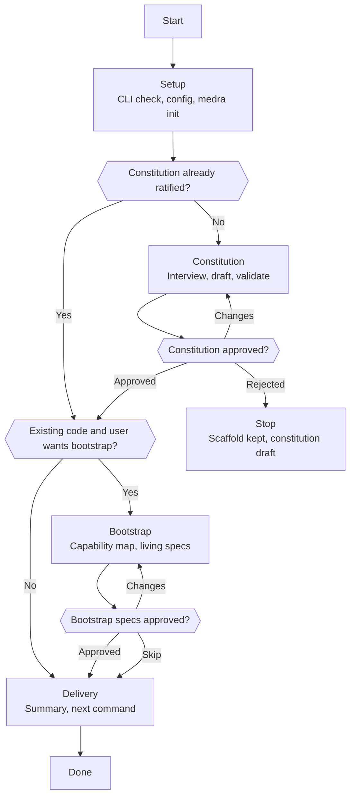

# Skill: Pipeline — Init

## Purpose

This pipeline makes a project ready for medra. It leaves behind a `docs/` scaffold and config written by the CLI, a ratified `docs/constitution.md`, and, for an existing codebase, living specs that describe today's behavior. It runs interactively when the user runs init, with human gates on the constitution and on the bootstrap specs. It is the only author pipeline that writes living specs directly; everywhere else, living specs change only through archive.

## Presentation

Phase headers for this pipeline:

| Phase | Header |
|---|---|
| Setup | `Author \| Setup` |
| Constitution | `Author \| Constitution` |
| Bootstrap | `Author \| Bootstrap` |
| Delivery | `Author \| Delivery` |

## Flow



## Phases

### Phase 1 — Setup

**Goal**
A `docs/` scaffold whose `config-flow.yaml` records the user's language, integrations, testing mode and test command.

**Actions**
- Load `medra:conventions`, then run `medra --version` and confirm major version `1`
- Read `docs/config-flow.yaml` when it exists. For each setting it lacks, ask the user with `AskUserQuestion`: prose language, integrations (`claude`, `antigravity`, or both), testing mode (`tdd` as the recommended first option, then `test-after` and `none`), and the project's test command
- Run `medra init` with the answers as flags. When the config already exists, show the user the settings that differ from their answers and edit only the keys they confirm
- Read the JSON result and report what was created and what already existed

**Avoid**
- Don't overwrite an existing `docs/` file to apply a new answer — because an existing constitution or learnings store is project history; change only the config keys the user confirmed
- Don't guess the test command from the repository when the user leaves it blank — because a wrong command produces false red/green evidence in every apply; leave it unset and say so

**Exit when:**
- [ ] `medra init --json` returned `ok: true`
- [ ] `docs/config-flow.yaml` holds the language, integrations and testing mode the user chose
- [ ] With `antigravity` among the integrations, the result reported the installed plugin

---

### Phase 2 — Constitution

**Goal**
A `docs/constitution.md` of 3–9 checkable articles that the user approved and `medra constitution ratify` ratified.

**Actions**
- Load `medra:template-constitution`, then read the project's README, CLAUDE.md or AGENTS.md and its build and test configuration, to propose candidate principles grounded in the codebase
- Interview the user in `AskUserQuestion` batches of at most 4 questions: what must never break, architectural boundaries, testing floor (consistent with the chosen testing mode), simplicity limits, security and compliance floors
- Copy the template and write the articles, each with a MUST or MUST NOT principle, a yes/no Gate and a Rationale, then run `medra validate --project constitution`
- Run the gate as `medra:conventions` → Gate Protocol describes it, presenting the articles. On approval, run `medra constitution ratify --note "Initial constitution" --source init`. Constitution approvals are recorded by `ratify`, not by `medra gate`

**Avoid**
- Don't write generic principles copied from other projects — because an article that cannot fail a plan makes every Constitution Check a formality
- Don't exceed 9 articles — because every article is a row in every plan; fold related rules into one article, or leave preferences for the learnings store

**Exit when:**
- [ ] `medra validate --project constitution` exits `0`
- [ ] The user approved the articles in an explicit reply
- [ ] `medra status --json` reports the constitution `ratified` at version `1.0`

---

### Phase 3 — Bootstrap

**Goal**
Living specs under `docs/specs/` that describe the existing code's current behavior, one per capability, approved by the user.

**Actions**
- Ask the user whether to bootstrap now, and which areas to cover. Map the codebase's user-facing capabilities: on Claude Code, use the Explore agent for broad navigation; elsewhere, read the entry points and routes directly
- Present the capability map (names, ID prefixes, one-line purposes) and confirm it with the user before writing any spec
- Load `medra:template-spec` and write one living spec per confirmed capability, describing behavior the code shows today and marking doubts `[NEEDS CLARIFICATION: …]`
- Resolve every marker with the user, run `medra validate --project specs`, then gate the specs with the Gate Protocol's render and options. Bootstrap specs belong to no change, so the decision is recorded in the conversation and in the suggested commit, not with `medra gate`

**Avoid**
- Don't describe intended or ideal behavior — because bootstrap specs are the baseline future deltas are written against; a spec that claims behavior the code lacks makes the first MODIFIED delta wrong
- Don't spec every internal module — because living specs cover user-facing behavior; internals belong in plans, and an over-split capability map multiplies every future context pack

**Exit when:**
- [ ] The user confirmed the capability map before any spec was written
- [ ] `medra validate --project specs` exits `0` and no marker remains
- [ ] The user approved the specs, or chose to skip bootstrap, in an explicit reply

---

### Phase 4 — Delivery

**Goal**
A short summary that leaves the user ready to propose a first change.

**Actions**
- Report the config settings, the constitution version and article count, and the number of capabilities and requirements bootstrapped
- Suggest a commit as `medra:conventions` → Commit Suggestions describes it
- Name the next command: `/medra:propose` followed by the first intent

**Avoid**
- Don't paste the constitution or the specs into the summary — because the files are the source of truth; give paths and counts

**Render**

```
> # Author | Delivery
> *init · medra {version}*
>
> 🔧 **Config**
> Language: `{language}` · Integrations: `{list}` · Testing: `{mode}`
>
> 📜 **Constitution**
> Version: `{version}` · Articles: `{n}`
>
> 🗂️ **Living specs**
> Capabilities: `{n}` · Requirements: `{n}`
>
> 👉 **Next**
> `/medra:propose "{intent}"`
```

**Exit when:**
- [ ] The summary shows the constitution version and the capability count, read from `medra status --json`
- [ ] The next command and a commit suggestion were given
