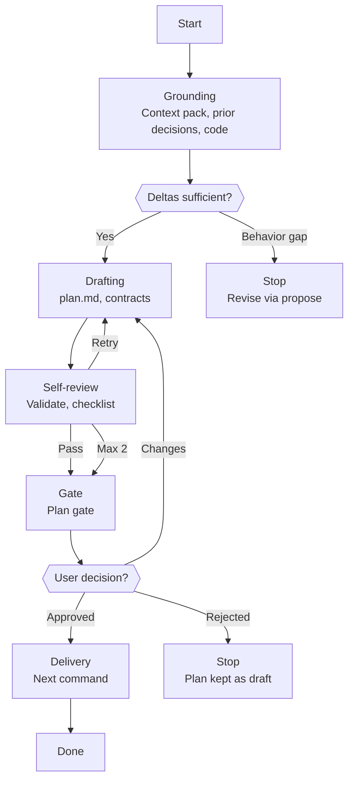

# Skill: Pipeline — Plan

## Purpose

This pipeline produces an approved `plan.md`, plus `contracts/` files when interfaces change, for a full-track change whose proposal gate is approved. It runs interactively, with one human gate on the plan. It is the step where technology and structure are decided, checked against every constitution article, and where earlier decisions are read before a requirement is changed.

## Presentation

Phase headers for this pipeline:

| Phase | Header |
|---|---|
| Grounding | `Author \| Grounding` |
| Drafting | `Author \| Drafting` |
| Self-review | `Author \| Self-review` |
| Gate | `Author \| Gate` |
| Delivery | `Author \| Delivery` |

## Flow

## Phases

### Phase 1 — Grounding

**Goal**
A verified factual base for the design: the change's requirements, the constitution's gates, the prior decisions behind every requirement being changed, and the code areas involved.

**Actions**
- Load `medra:conventions` and `medra:template-plan`, then run `medra context <change> --stage plan --json`
- For each MODIFIED or REMOVED requirement with a `last_changed_by` pointer, read only that archived change's `## Decisions` (or its `## Why` when it has no plan)
- Read the code the requirements touch: on Claude Code, use the Explore agent when the area is unfamiliar; otherwise read the files directly. Note the paths, patterns and constraints you verified
- Ask the user, with `AskUserQuestion`, only the technical questions whose answers change the design. Present each as options with your recommendation first

**Avoid**
- Don't design around behavior the deltas do not state — because the plan gate does not re-approve behavior; when a behavior gap appears, stop and tell the user to revise the change with `/medra:propose <change>`
- Don't browse the archive beyond the pointed sections — because the living spec and the context pack already carry current behavior; the archive is read only for the why

**Exit when:**
- [ ] Every requirement in the context pack is understood, and every behavior gap was either ruled out or surfaced to the user
- [ ] Every module and path the design will name was verified in the codebase
- [ ] Every prior-decision pointer for a MODIFIED or REMOVED requirement was read

---

### Phase 2 — Drafting

**Goal**
A `plan.md` whose anchors are filled and whose design satisfies every delta requirement inside the proposal's scope.

**Actions**
- Copy the template and write the Summary and the freehand sections this change needs, pointing at `contracts/` files for any interface definition
- Fill the Constitution Check with one row per live article from the context pack, and add a Complexity Tracking row for every `fail`
- Write the Test Strategy for `testing.mode`, mapping every delta scenario ID to a level and a test location
- Record each consequential choice as a `D-NN` Decision, including where it keeps or reverses a prior decision you read

**Avoid**
- Don't mark an article `pass` without evidence in this plan — because the reviewer re-checks each row, and an unsupported pass turns the constitution into a formality
- Don't reverse a prior decision silently — because the next change to this requirement will read your Decisions; state the reversal and its reason

**Exit when:**
- [ ] `plan.md` exists with all six anchors in order
- [ ] Every delta scenario ID appears in the Test Strategy, or the mode is `none` and the no-tests reason is written
- [ ] Every `fail` row has a Complexity Tracking justification

---

### Phase 3 — Self-review

**Goal**
A plan that passes `medra validate` and an adversarial read against the template checklist, with residual failures recorded.

**Actions**
- Run `medra validate <change> --stage plan --json` and fix every `error`
- Read `plan.md` back from disk and run the `medra:template-plan` Quality Checklist
- Attack the design: a requirement no section satisfies, a path that does not exist, a decision without alternatives, work outside the proposal's In scope. Fix what you find, and record what remains after two rounds

**Avoid**
- Don't review from memory — because the plan you remember is the one you intended; the tasks step reads the one on disk

**Exit when:**
- [ ] `medra validate <change> --stage plan` exits `0`, or its remaining findings are recorded for the gate
- [ ] Every checklist item passes, or its failure is recorded

---

### Phase 4 — Gate

**Goal**
A plan-gate decision recorded by `medra gate`.

**Actions**
- Run the gate as `medra:conventions` → Gate Protocol describes it, for gate `plan`. Present the Constitution Check counts (pass, fail, n/a), every Complexity Tracking row, and the two or three decisions most worth contesting
- Record the decision with `medra gate`
- When a requested change alters behavior rather than design, record it as request-changes and route the user to `/medra:propose <change>`

**Avoid**
- Don't bundle a behavior change into the plan approval — because the plan gate's hash covers only the plan; behavior changes go back through the proposal gate

**Exit when:**
- [ ] `medra status <change> --json` shows gate `plan` as `approved` or `changes-requested`, or the user rejected it
- [ ] Every request-changes note was recorded through `medra gate --note`

---

### Phase 5 — Delivery

**Goal**
A bounded summary that names the next command.

**Actions**
- Report the plan path, the Constitution Check counts, the number of decisions and the number of contract files
- Suggest a commit as `medra:conventions` → Commit Suggestions describes it
- Name the next command: `/medra:tasks`

**Avoid**
- Don't paste the plan into the summary — because the file is the source of truth

**Exit when:**
- [ ] The summary names the plan path and the next command
- [ ] A commit suggestion was given
