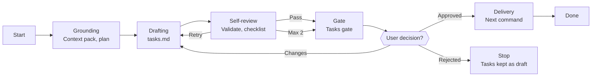

# Skill: Pipeline — Tasks

## Purpose

This pipeline produces an approved `tasks.md` for a full-track change whose plan gate is approved. The file holds ordered, traceable tasks that any session can execute one at a time. It runs interactively, with one human gate on the task list. It differs from the fast-track tasks written during propose by working from an approved plan: phases follow the plan's structure, and test tasks follow its Test Strategy.

## Presentation

Phase headers for this pipeline:

| Phase | Header |
|---|---|
| Grounding | `Author \| Grounding` |
| Drafting | `Author \| Drafting` |
| Self-review | `Author \| Self-review` |
| Gate | `Author \| Gate` |
| Delivery | `Author \| Delivery` |

## Flow

## Phases

### Phase 1 — Grounding

**Goal**
A clear map, before any task is written, of what must be delivered (the delta requirements), in what structure (the plan), and under which testing mode.

**Actions**
- Load `medra:conventions` and `medra:template-tasks`, then run `medra context <change> --stage tasks --json`
- Read `plan.md`, focusing on the Test Strategy, the freehand structure and the Decisions, then read `testing.mode` from `docs/config-flow.yaml`
- When a draft `tasks.md` exists (from a fast track that escalated, or from a request-changes round), read it and the pending gate notes as the starting point

**Avoid**
- Don't re-open design questions the plan settled — because the plan gate already approved them; a task list that redesigns forces a second plan review nobody scheduled

**Exit when:**
- [ ] Every ADDED and MODIFIED requirement from the context pack is listed for coverage
- [ ] The testing mode and the plan's Test Strategy are known

---

### Phase 2 — Drafting

**Goal**
A `tasks.md` whose every line parses, whose phases follow the plan, and whose order is test-first in `tdd` mode.

**Actions**
- Copy the template and organize phases: Setup only for shared groundwork, then one phase per requirement or coupled group, in the plan's order
- Write each task as a focused unit naming its requirement IDs, its path and a concrete verify clause. Take test tasks from the Test Strategy rows
- In `tdd` mode, place each requirement's `[TEST]` task before its implementation tasks and add `after` links. Mark `[P]` only where a task has no dependency inside its phase
- When `threat-model.md` exists, give every `accepted` mitigation at least one task that cites its `M-NN` in the description, with a verify clause that shows the control works (a test that the attack fails, where one can be written)
- Apply every pending gate note from an earlier round

**Avoid**
- Don't write oversized tasks ("implement the reset flow") — because the apply step checkpoints per task; a task too big for one session loses work on compaction and hides partial progress
- Don't tick boxes or write evidence lines — because only `medra task done` may, and a hand tick produces a done task with no evidence

**Exit when:**
- [ ] `tasks.md` exists and every task line follows the template grammar
- [ ] Every ADDED and MODIFIED requirement is referenced by at least one task
- [ ] Every `accepted` mitigation in `threat-model.md` is cited by at least one task

---

### Phase 3 — Self-review

**Goal**
A task list that passes `medra validate` and an adversarial read, with residual failures recorded.

**Actions**
- Run `medra validate <change> --stage tasks --json` and fix every `error`, then read the file back from disk and run the `medra:template-tasks` Quality Checklist
- Attack the order: an implementation task that could run before its test, a dependency hidden in a `[P]` task, a path neither existing nor created by an earlier task, a requirement covered only partially. Fix what you find
- After two rounds, record what remains for the gate

**Avoid**
- Don't treat a passing `validate` as review — because the CLI checks grammar, coverage and ordering, not whether each task actually delivers its requirement

**Exit when:**
- [ ] `medra validate <change> --stage tasks` exits `0`, or its remaining findings are recorded for the gate
- [ ] Every checklist item passes, or its failure is recorded

---

### Phase 4 — Gate

**Goal**
A tasks-gate decision recorded by `medra gate`.

**Actions**
- Run the gate as `medra:conventions` → Gate Protocol describes it, for gate `tasks`. Present the phase count, the task count, the number of `[TEST]` tasks and the parallelizable count, plus any recorded residual failure
- Record the decision with `medra gate`
- When a requested change needs a task outside the approved deltas or plan, record it as request-changes and route the user to `/medra:propose <change>` or `/medra:plan`

**Avoid**
- Don't present the full task list inline — because the file is open to the user; give the counts and the questions worth deciding

**Exit when:**
- [ ] `medra status <change> --json` shows gate `tasks` as `approved` or `changes-requested`, or the user rejected it
- [ ] Every request-changes note was recorded through `medra gate --note`

---

### Phase 5 — Delivery

**Goal**
A bounded summary that names the next command.

**Actions**
- Report the tasks path and the task counts
- Suggest a commit as `medra:conventions` → Commit Suggestions describes it
- Name the next command: `/medra:apply`

**Avoid**
- Don't start implementing — because implementation belongs to the implementer under the apply command, with its own checkpoints

**Exit when:**
- [ ] The summary names the tasks path and the next command
- [ ] A commit suggestion was given
