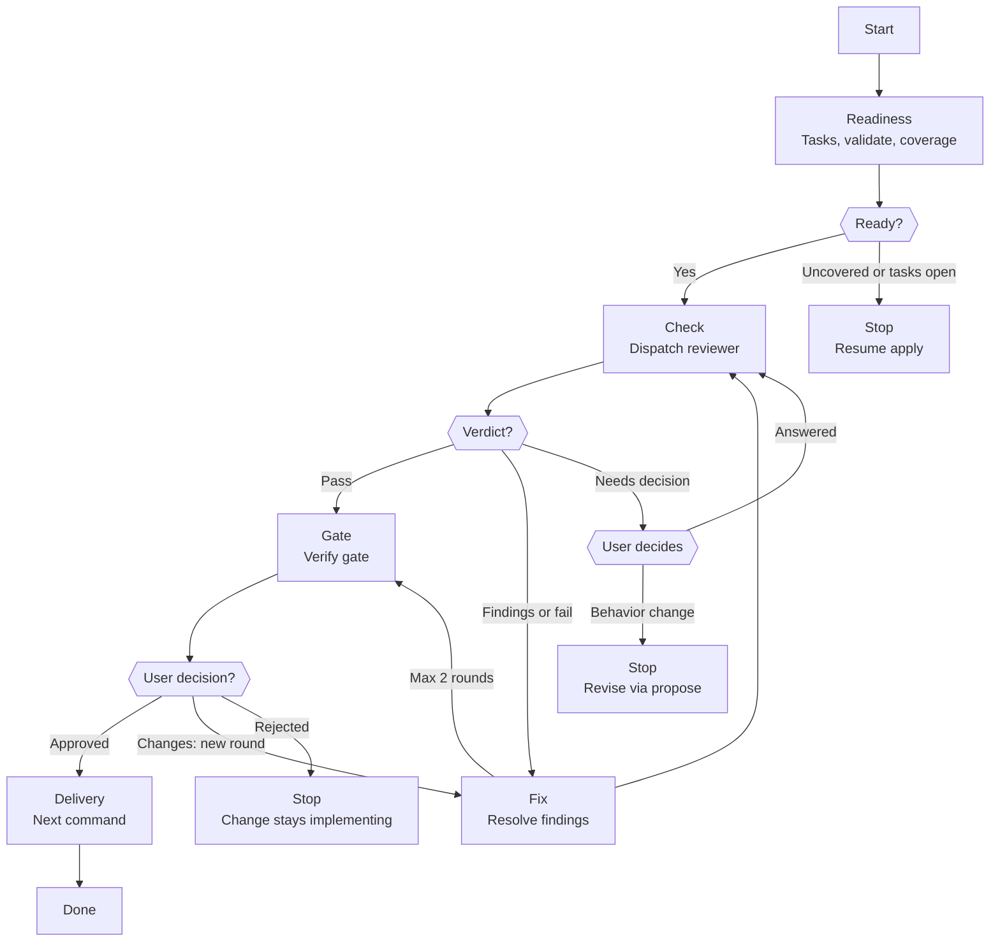

# Skill: Pipeline — Verify

## Purpose

This pipeline produces an approved verify gate: proof that the implementation does what the approved deltas say, backed by a verification report written by the reviewer. It runs interactively when the user runs verify, with one human gate. The reviewer's check runs in an isolated subagent on Claude Code and Antigravity, and inline on runtimes without subagents, and the implementer fixes findings between rounds. It differs from apply by judging finished work, and from review by checking code rather than documents.

## Presentation

Phase headers for this pipeline:

| Phase | Header |
|---|---|
| Readiness | `Implementer \| Readiness` |
| Check | `Implementer \| Check` |
| Fix | `Implementer \| Fix` |
| Gate | `Implementer \| Gate` |
| Delivery | `Implementer \| Delivery` |

## Flow

## Phases

### Phase 1 — Readiness

**Goal**
Confirmation that the change satisfies the handoff's dispatch preconditions and that every changed scenario has a covering test.

**Actions**
- Load `medra:conventions` and `medra:handoff-implementer-reviewer`, then run `medra status <change> --json` and confirm that every task is done
- Run `medra validate <change> --stage tasks --json` and `medra coverage <change> --json`
- When the mode is `tdd` or `test-after` and coverage lists uncovered scenarios, stop and tell the user to resume `/medra:apply` with a test task for each one

**Avoid**
- Don't write missing tests here outside a task — because a test with no task has no red/green evidence; route it through apply, where it is checkpointed

**Exit when:**
- [ ] `medra status` reports every task done
- [ ] `medra coverage` reports no uncovered scenario, or the mode is `none`

---

### Phase 2 — Check

**Goal**
A verification report at the dispatched `report_path`, and a validated response payload.

**Actions**
- Compose the dispatch payload exactly as the handoff's Dispatch section defines it, using `round: 1` on the first pass. On later rounds, set `round` to one more than the highest `-r<N>` report in `reviews/`, and add `previous_report` (that report) and `fixed_findings`
- On Claude Code, call the Agent tool with the reviewer agent and the payload; on Antigravity, `invoke_subagent`. On a runtime without subagents, run the reviewer's check inline, following `medra:conventions` → Runtime Portability
- Validate the response against the handoff's Validation rules. When it fails, follow its Error Handling
- When the response is `needs-decision`, put its question to the user with `AskUserQuestion`, then re-dispatch with the answer recorded in the change's documents (through `/medra:propose <change>` when the answer changes behavior)

**Avoid**
- Don't summarize the code into the payload — because the handoff passes pointers; inlined code bloats both contexts and drifts from the files the reviewer must read

**Exit when:**
- [ ] The report exists at `report_path`, and its Verdict and Counts lines equal the response
- [ ] The response passed the handoff's Validation rules

---

### Phase 3 — Fix

**Goal**
Every critical and major finding from the latest report resolved in code, ready for a re-check.

**Actions**
- Read the report's findings in severity order, and fix each critical and major finding in code and tests, re-running the affected tests to green
- Fix a minor finding when the fix is local and safe. Otherwise leave it for the gate, noting why
- Collect the fixed finding IDs for the next dispatch's `fixed_findings`, then return to Check with `round` incremented. After round 2, go to the gate with whatever remains
- When the gate returns request-changes, fix the gate notes here, then always run one more Check with the next `round`, outside the two-round limit, and go back to the gate with its verdict without further Fix rounds. Each request-changes at the gate opens exactly one such round

**Avoid**
- Don't argue a finding by editing the report — because the report is the reviewer's record; disagreement goes to the user at the gate
- Don't change behavior beyond what a finding asks — because each fix must stay inside the approved deltas, like any apply work
- Don't go to the gate after a code change without a new Check round — because the current report then describes code that no longer exists, and `verify.report` only detects changes made through `medra task done`

**Exit when:**
- [ ] Every critical and major finding is fixed or explicitly left for the gate
- [ ] The tests affected by the fixes pass

---

### Phase 4 — Gate

**Goal**
A verify-gate decision recorded by `medra gate`.

**Actions**
- Run `medra validate <change> --stage verify --json`. When `verify.report` fails because code changed after the last check, return to Check
- Run the gate as `medra:conventions` → Gate Protocol describes it, for gate `verify`. Present the report of the highest round (the one `verify.report` validated) with its verdict and counts, the number of check rounds, the coverage ratio, and any finding left unresolved together with its reason
- Record the decision with `medra gate`

**Avoid**
- Don't present a `fail` verdict as approvable without stating each unresolved critical finding — because approving verify lets archive merge the deltas into living specs as if they were true

**Exit when:**
- [ ] `medra status <change> --json` shows gate `verify` as `approved` or `changes-requested`, or the user rejected it
- [ ] Every request-changes note was recorded through `medra gate --note`

---

### Phase 5 — Delivery

**Goal**
A bounded summary that names the next command.

**Actions**
- Report the report path, the verdict, the counts, the coverage ratio and the number of check rounds
- Suggest a commit as `medra:conventions` → Commit Suggestions describes it
- Name the next command: `/medra:archive`

**Avoid**
- Don't paste the findings — because they are in the report file

**Exit when:**
- [ ] The summary names the report path and the next command
- [ ] A commit suggestion was given
