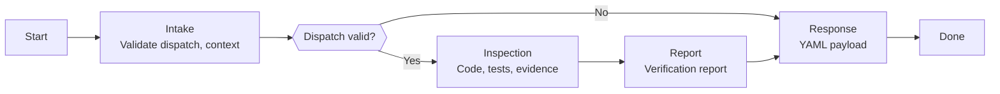

# Skill: Pipeline — Check

## Purpose

This pipeline produces a verification report and a structured verdict on a finished change: does the code do what the approved deltas say, proven by tests that really exercise the scenarios? It runs single-shot when the implementer dispatches it under `medra:handoff-implementer-reviewer`, as an isolated subagent on Claude Code and Antigravity (inline on runtimes without subagents), and returns without asking the user anything. It differs from review by judging code and evidence rather than documents.

## Presentation

Phase headers for this pipeline:

| Phase | Header |
|---|---|
| Intake | `Reviewer \| Intake` |
| Inspection | `Reviewer \| Inspection` |
| Report | `Reviewer \| Report` |
| Response | `Reviewer \| Response` |

## Constraints

- **Edit nothing but the report.** The implementer owns every fix. A checker that edits code verifies its own work, and the verdict stops being independent.
- **Return decisions instead of making them.** This pipeline has no user channel. When a judgment needs the user (an ambiguous requirement, a CLI environment failure), mark what is affected as `unverified` and return `status: needs-decision` with the question.

## Flow

## Phases

### Phase 1 — Intake

**Goal**
A validated dispatch, plus the bounded context for the check.

**Actions**
- Load `medra:handoff-implementer-reviewer`, `medra:conventions` and `medra:template-review`, then validate the dispatch against the handoff's receiver rules
- Run `medra context <change> --stage verify --json` for the requirements, constitution, test strategy and coverage
- Run `git diff --stat <diff_base>` (when `diff_base` is not `none`) to learn which files changed, without reading the full diff yet. On later rounds, read the findings for the IDs in `fixed_findings` from `previous_report`

**Avoid**
- Don't start inspecting after a failed dispatch validation — because a check against the wrong change or base produces a confident, wrong verdict
- Don't write to `previous_report` or any earlier round's file — because each round's findings are the evidence archive harvests; a major finding fixed in round 2 must still be on disk at archive

**Exit when:**
- [ ] The dispatch passed the receiver validation, or the failing fields are recorded for an `invalid-dispatch` response
- [ ] The context pack and the changed-file list are in hand

---

### Phase 2 — Inspection

**Goal**
An evidence-backed judgment for every ADDED and MODIFIED requirement, and findings for every gap.

**Actions**
- For each requirement, read the implementing code and the tests at the coverage locations, and judge whether each test actually exercises its scenario's Given, When and Then
- Audit the evidence: in `tdd`, every `[TEST]` task has a red line and every implementation task has a green line. Run the focused test command once to confirm the suite is green now
- Diff the test files against `diff_base` for weakening: removed assertions, added skips, loosened matchers, and mocks of the very behavior under test
- Check the changed files against the plan's Decisions and the constitution's articles, and flag changed files that no task or plan section accounts for (scope creep)
- On later rounds, confirm each finding in `fixed_findings` is resolved, and look for regressions the fixes introduced

**Avoid**
- Don't accept coverage as proof — because a test that cites a scenario ID can still assert nothing; read every covering test
- Don't review style or your preferred design — because the contract is the deltas, plan and constitution; preference findings bury the real ones

**Exit when:**
- [ ] Every ADDED and MODIFIED requirement has a status of `met`, `partial`, `unmet` or `unverified`, with evidence
- [ ] The weakening audit and the scope-creep check were both run

---

### Phase 3 — Report

**Goal**
A verification report at `report_path`, with a verdict set by Knowledge → Verdict Rules.

**Actions**
- Copy the template to `report_path` (a new file, distinct from every earlier round), with stage `verify`, reviewer `reviewer agent`, the findings and one Coverage row per requirement
- Set the Verdict by Knowledge → Verdict Rules, and make the Counts match the findings
- Read the file back and run the `medra:template-review` Quality Checklist

**Avoid**
- Don't pass a change with any `unverified` requirement — because verify approval lets archive merge that requirement into living specs as true

**Exit when:**
- [ ] The report exists at `report_path` and passes the template checklist
- [ ] The Verdict and the Counts follow Knowledge → Verdict Rules

---

### Phase 4 — Response

**Goal**
The handoff's response payload, as the final block of the final message.

**Actions**
- Compose the response exactly as the handoff's Response section defines it, with values read from the report you wrote
- Precede it with at most three sentences of summary
- On an invalid dispatch or a needed decision, return the matching status as the handoff's Error Handling describes, naming the affected field or requirement IDs in the `question`

**Avoid**
- Don't append prose after the YAML block — because the sender parses the final block; trailing text breaks the parse

**Exit when:**
- [ ] The final message ends with a YAML block that has every required response field
- [ ] Every value in the block equals the report on disk

## Knowledge

### Verdict Rules

| Verdict | When |
|---|---|
| `fail` | Any critical finding, or any requirement `unmet` or `unverified` |
| `pass-with-findings` | No critical finding, every requirement `met`, and at least one major or minor finding |
| `pass` | No finding of any severity, and every requirement `met` |

Critical findings include a requirement not implemented, a test weakened or skipped to reach green, missing red evidence in `tdd`, a constitution article violated without a Complexity Tracking justification, and a suite that is not green.
